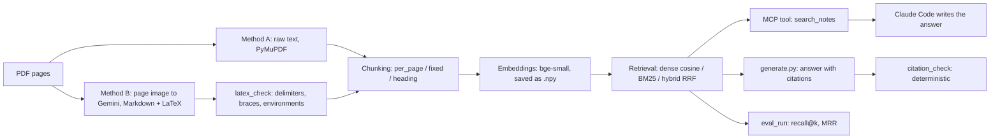

# Notes RAG + MCP (learning project)

Search and question answering over my own math-heavy lecture notes (PDFs), built in plain Python with no RAG framework and no vector database. It has an eval set of 20 questions, measured retrieval numbers, a deterministic citation check, and an MCP tool so Claude Code can search the notes.

This is a learning project. The goal was to understand each part (chunking, embeddings, retrieval, evals, guardrails, MCP), not to ship a product. Every metric below is generated by a script from `results/*.json`; none is typed by hand.

## Pipeline



- **Ingestion:** raw PyMuPDF text (A) against Gemini vision transcription to Markdown with LaTeX (B). Pages whose LaTeX fails the checks are flagged, not silently used.
- **Chunking:** `per_page`, `fixed` (500 words, 80 overlap), `heading`. No strategy cuts inside a `$...$` or `$$...$$` span.
- **Retrieval:** dense search (normalized embeddings, cosine as a dot product, NumPy), BM25 (`rank_bm25`), and hybrid with reciprocal rank fusion.
- **Answering:** the prompt labels each chunk `[file p.N]`; the model must cite those labels or reply exactly `Not in the notes.`
- **Check:** `citation_check.py` finds the tags and applies three rules (`missing_citation`, `unretrieved_citation`, `answered_when_unanswerable`). It reads labels, not meaning.

## Results

<!-- RESULTS:START -->
*This block is generated by `python -m src.make_readme` from `results/*.json`. Do not edit it by hand.*

#### Retrieval experiments (answerable questions only)

### E1: ingestion (per_page chunks, dense search)

| config | recall@1 | recall@3 | recall@5 | MRR | MRR math | MRR non-math |
|---|---|---|---|---|---|---|
| raw text (PyMuPDF) | 0.59 | 0.73 | 0.75 | 0.78 | 1.00 | 0.42 |
| vision transcription | 0.59 | 0.70 | 0.84 | 0.77 | 1.00 | 0.41 |

Best by the rule: **raw text (PyMuPDF)**

Near tie (MRR within 0.05 of the best, about one question): vision transcription. Do not read this as a real difference.

### E2: chunking (vision text, dense search)

| config | recall@1 | recall@3 | recall@5 | MRR | MRR math | MRR non-math |
|---|---|---|---|---|---|---|
| per_page | 0.59 | 0.70 | 0.84 | 0.77 | 1.00 | 0.41 |
| fixed 500 / overlap 80 | 0.43 | 0.83 | 0.89 | 0.65 | 0.80 | 0.41 |
| heading | 0.50 | 0.86 | 0.86 | 0.74 | 0.95 | 0.40 |

Best by the rule: **per_page**

Near tie (MRR within 0.05 of the best, about one question): heading. Do not read this as a real difference.

### E3: retrieval (per_page chunks, vision text)

| config | recall@1 | recall@3 | recall@5 | MRR | MRR math | MRR non-math |
|---|---|---|---|---|---|---|
| dense | 0.59 | 0.70 | 0.84 | 0.77 | 1.00 | 0.41 |
| BM25 | 0.29 | 0.62 | 0.69 | 0.58 | 0.60 | 0.54 |
| hybrid (RRF, k=60) | 0.48 | 0.69 | 0.87 | 0.71 | 0.80 | 0.57 |

Best by the rule: **dense**

#### Generation and citation check (all 20 questions)

| run | citation check passed | false abstentions | abstained on unanswerable | failures |
|---|---|---|---|---|
| run 1 (first parser) | 14 of 17 | q06 | 2 of 2 | unretrieved_citation x3 |
| run 2 (stricter parser) | 14 of 17 | q06 | 2 of 2 | missing_citation x3 |

#### The failure case: q01

Question q01: *What themes form the foundation for the application of the Hamming Scheme?*  Gold page(s): [2]

| search | rank of the gold page (top 10 checked) | pages returned, best first (top 5) |
|---|---|---|
| dense | not in top 10 | 26, 1, 3, 24, 8 |
| BM25 | 1 | 2, 8, 9, 26, 21 |
| hybrid (RRF, k=60) | 5 | 26, 8, 1, 24, 2 |

<!-- RESULTS:END -->

How to read the retrieval tables: the metrics are recall@k (share of gold pages found in the top-k chunks) and MRR (mean of 1 / rank of the first chunk that hits a gold page, looking at the top 10). `recall@k` is not comparable across chunking strategies, because a bigger chunk covers more pages for the same k. MRR and recall@1 are the fairer comparison.

What the tables support, and what they do not:
- **Ingestion (E1) is a near tie.** One question moves MRR by about one twentieth, so the raw-versus-vision difference is within noise. The notes are mostly prose, and the words of the prose are enough to find a page. I do not claim that vision transcription improves retrieval. Its value here is readable formulas, and it matters for scanned PDFs, which this corpus does not contain yet.
- **Dense search wins overall, but not everywhere.** On math questions dense is far ahead of BM25; on non-math questions BM25 is ahead of dense. Hybrid sits in between and did not beat dense on the overall rule, which was fixed before running the experiments.
- **The best config used by the MCP server** is `per_page` chunks, vision text, dense search. Vision was kept for later steps as a judgment call (the E1 rule technically favours raw text), not because it was shown to retrieve better.

## The failure case

Question q01 is a broad question: it names a topic but no specific term from the page. The table above shows what each search did with it.

**Dense search** ranked the right page outside the top 10. Its scores for the first ten pages are almost the same, so there is no clear winner, and pages that read like overviews of the whole notes rise to the top. A broad question carries many meanings at once, and one embedding vector cannot point at a single page.

**BM25** ranked the right page first, with a clear gap to the second page. The question contains the exact words that appear on that page, and BM25 rewards exact, rare words.

**Hybrid** put the right page fifth. Reciprocal rank fusion averages the two rankings, so dense's bad rank pulled BM25's good one down.

What this says: dense and BM25 fail on different questions. Dense is better when the question is a paraphrase or a math concept; BM25 is better when the question contains the page's own words. A fixed rule that picks one method for all questions leaves some questions behind.

## Limitations (kept honest)

- **Small sample.** 20 questions, 18 of them answerable. One question changes MRR by about one twentieth. I would not trust differences smaller than that, and I did not tune anything after seeing the results.
- **I wrote the questions after reading the notes.** They tend to paraphrase the pages, which favours dense search. A set written by someone else would be a fairer test.
- **Label problems in my own eval set.** q07 has gold page 15 though page 14 also defines the Krawtchouk polynomial; q13 (portfolio risk) is discussed on several pages but has one gold page; q12 and q14 are near duplicates; q15 is a counting question. I left the labels as I wrote them rather than fix them after seeing results.
- **Only one PDF.** The vision path was never tested on a scanned PDF.
- **Chunks are longer than the embedding model can read.** I measured chunk size in words, but `bge-small-en-v1.5` reads at most 512 of its own tokens and silently ignores the rest, and LaTeX-heavy text takes about two model tokens per word. Checked on the saved indexes: 7 of 26 `per_page` chunks, 14 of 15 `fixed` chunks (median about 960 tokens) and 5 of 39 `heading` chunks are longer than 512 tokens. So for those chunks the dense search only sees the beginning, and the chunking comparison (E2) is partly a comparison of how much of each chunk was embedded. BM25 reads the full text. I did not change the chunk sizes after seeing this, because that would be tuning on the eval set; fixing it is the first thing to try next.
- **Citation check limits.** It proves a label is traceable to a retrieved page. It does not prove the claim is true: a wrong formula with a valid tag passes. It also reads only the exact `[file p.N]` format. The model sometimes groups tags (`[F p.1, F p.2]`) or escapes the underscore in the file name; the stricter check treats those as failures, and the two generation runs differ only by that parser change. The failing questions also change between runs, because the model is not fully repeatable even at temperature 0.
- **Abstention is enforced only in `generate.py`.** Through the MCP tool the client model writes the answer. In a live test, Claude Code said an option-pricing question was not in the notes and then answered it from memory anyway. A tool description can ask for good behaviour, but cannot enforce it.
- **Token counts are logged only for the `generate.py` path.** The MCP server calls no LLM and cannot see the client's usage. Latency: the first search after the server starts waits for the embedding model to load; later searches take milliseconds.

## MCP tool

`src/mcp_server.py` exposes one tool, `search_notes(query, k=5)`, over stdio. It returns a list of `{file, page, score, text}` using the best config above. It only retrieves; the client model writes the answer. It must never print to stdout, because stdout carries the protocol messages.

Register it for Claude Code by putting a `.mcp.json` in the project folder (use your own absolute paths):

```json
{
  "mcpServers": {
    "notes": {
      "type": "stdio",
      "command": "<project folder>\\.venv\\Scripts\\python.exe",
      "args": ["-m", "src.mcp_server"],
      "env": { "PYTHONPATH": "<project folder>" }
    }
  }
}
```

With the command-line tool, the equivalent is `claude mcp add --env PYTHONPATH=<project folder> --transport stdio notes -- <project folder>\.venv\Scripts\python.exe -m src.mcp_server`.

Each query is appended to `logs/queries.jsonl`; `python -m src.log_report` prints p50 and p95 latency per stage and total tokens.

## What I would do differently

Since this RAG project is for me to learn and actually build a pdf notes dictionary of my questions, it needs more refining work to do since it can only detect structural broken LaTeX. What I would do in the future is to definitely put in the ai models like ministral-14b-2512 to become the cross check personnel, and crosscheck with another gemini model on its answers.

## Setup and run

```bash
python -m venv .venv
.venv\Scripts\activate
pip install -r requirements.txt
copy .env.example .env   # then add GEMINI_API_KEY
python -m pytest -q
```

Put PDFs in `data/pdfs/` (not committed). Main commands, in order:

```bash
python -m src.ingest_raw          # Method A text
python -m src.ingest_vision       # Method B transcription (Gemini calls)
python -m src.ingest_report       # LaTeX checks per page
python -m src.build_index --strategy per_page --method vision
python -m src.search_cli          # type a query, see the top chunks
python -m src.eval_run --help     # retrieval experiments
python -m src.make_summary        # results/summary.md
python -m src.eval_generate --name <name>   # generation and citation check
python -m src.make_readme         # refresh the Results block above
```

See `DECISIONS.md` for every choice and its reason.
